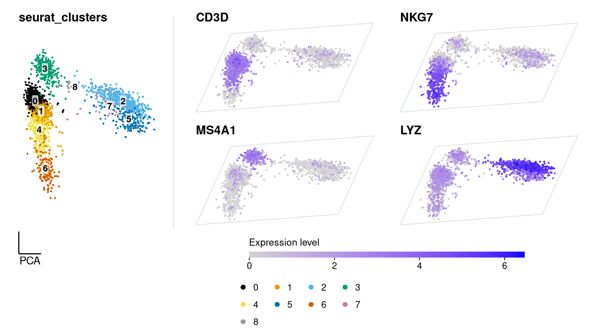
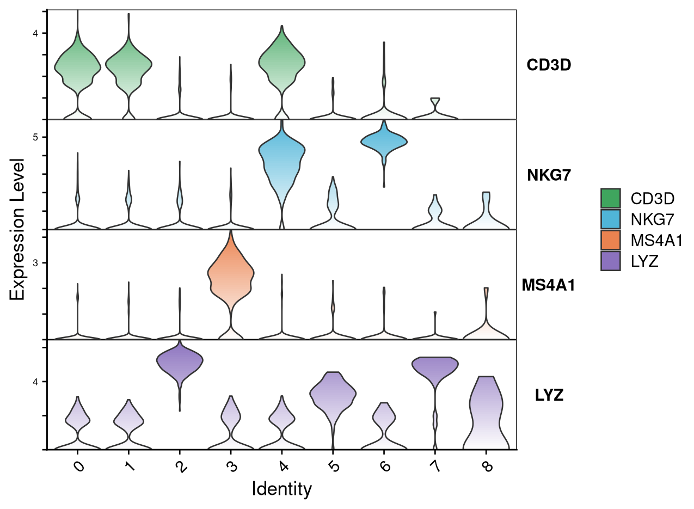
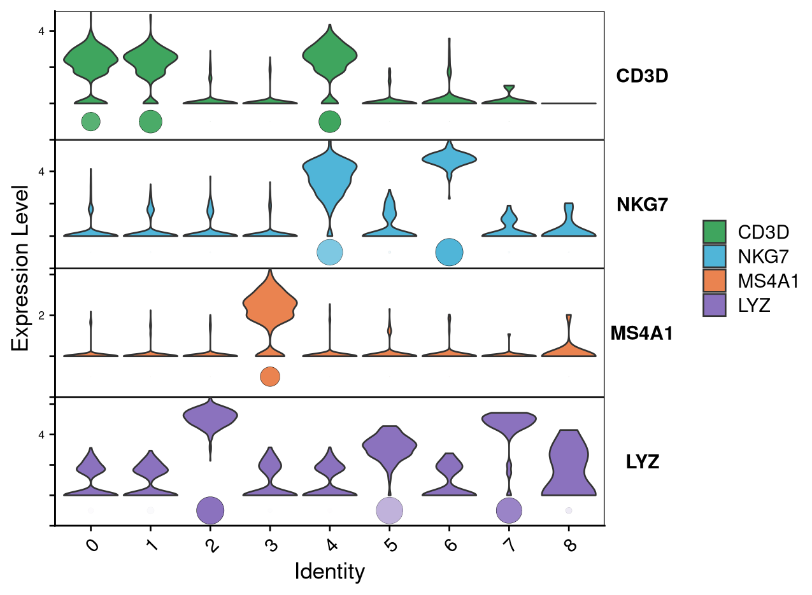

# A guided tutorial to use Seurcery v0.9.0

Use a single PBMC3K object to plot gene expression on UMAP or PCA and compare expression distributions across Seurat clusters.

[README](https://github.com/RuiyingChenBioinfo/Seurcery#readme) · [Release notes](../NEWS.md)

## Installation

Install from GitHub, then install Seurat to run the examples below.

``` r
install.packages("remotes")
remotes::install_github("RuiyingChenBioinfo/Seurcery")
install.packages("Seurat")
```

Alternatively, to install from a downloaded source archive, run the following from the directory containing the archive. Feature layers require SeuratObject \>= 5.0.0 and ggplot2 \>= 3.5.0.

``` r
install.packages(c("ggplot2", "SeuratObject", "patchwork", "rlang"))
install.packages("Seurcery_0.9.0.tar.gz", repos = NULL, type = "source")
```

Load the packages:

``` r
library(Seurat)
library(ggplot2)
library(Seurcery)
packageVersion("Seurcery")
# 0.9.0
```

## PBMC3K data

Install Satija Lab's PBMC3K dataset once. The processed `pbmc3k.final` object contains 2,638 cells with nine cluster IDs (0–8) in `seurat_clusters`. All examples use these IDs and the same four genes. Data from Satija Lab, [pbmc3k.SeuratData 3.1.4](https://seurat.nygenome.org/src/contrib/pbmc3k.SeuratData_3.1.4.tar.gz), licensed under [CC BY 4.0](https://creativecommons.org/licenses/by/4.0/).

``` r
install.packages(
  "https://seurat.nygenome.org/src/contrib/pbmc3k.SeuratData_3.1.4.tar.gz",
  repos = NULL, type = "source"
)
```

``` r
data("pbmc3k.final", package = "pbmc3k.SeuratData")
rds <- SeuratObject::UpdateSeuratObject(pbmc3k.final)
gl <- c("CD3D", "NKG7", "MS4A1", "LYZ")
```

`UpdateSeuratObject()` updates this archived object for SeuratObject v5. Warnings about command logs without an assay refer to the stored analysis history. The RNA expression values and original cluster IDs are preserved.

## FeatureLayerPlot()

The left panel shows the original cluster IDs on the UMAP. Each projected gene panel uses the same cells and coordinates. All genes share a colorbar for expression in the RNA assay's normalized `data` layer.

``` r
FeatureLayerPlot(
  rds, features = gl, group.by = "seurat_clusters",
  reduction = "umap", assay = "RNA"
)
```


PBMC3K clusters and gene expression on UMAP.

Set `reduction = "pca"` to use the first two stored principal components. The embedding label appears below two equal, perpendicular black lines.

``` r
FeatureLayerPlot(
  rds, features = gl, group.by = "seurat_clusters",
  reduction = "pca", assay = "RNA"
)
```


The same cells and genes on PCA.

### Categorical metadata and manual colors

Characters and factors use Seurat's default discrete colors. The left title is the metadata column name. To customize colors, name the palette with the category levels and pass a manual scale to `group.scale`.

``` r
ids <- levels(factor(rds$seurat_clusters))
pal <- setNames(grDevices::hcl.colors(length(ids), "Dark 3"), ids)

FeatureLayerPlot(
  rds, gl, group.by = "seurat_clusters", reduction = "pca",
  group.scale = scale_color_manual(values = pal)
)

# A fill scale updates the same reference map and legend.
FeatureLayerPlot(
  rds, gl, group.by = "seurat_clusters", reduction = "pca",
  group.scale = scale_fill_manual(values = pal)
)
```



The manual color and fill scales give the same cluster colors.

For a continuous metadata column, the reference map uses a Reds palette and a separate colorbar. Use `feature.cols` to change the expression gradient and `text.color` to change text colors.

### Ordering and spacing

`order = TRUE` draws higher values last so they appear above lower values. This applies to gene expression and numeric metadata. `order = FALSE` keeps the original cell order.

| Argument    | Default | Meaning                                                |
|-------------|---------|--------------------------------------------------------|
| `ncol`      | `2`     | Number of gene-panel columns.                          |
| `gap.x`     | `0.18`  | Horizontal gap; must be greater than zero.             |
| `gap.y`     | `0.16`  | Vertical gap; at least `max(0.10, title.gap + 0.037)`. |
| `title.gap` | `0.04`  | Gene-title offset above its panel; at least `0.037`.   |

Gaps are expressed in normalized plot coordinates. Smaller values make the layout more compact. Invalid gaps cause an error before plotting, keeping the panels and their reserved title space separate.

``` r
p <- FeatureLayerPlot(
  rds, gl, group.by = "seurat_clusters", reduction = "pca",
  order = TRUE, gap.x = 0.06, gap.y = 0.11, title.gap = 0.04
)
ggsave("feature-layers.pdf", p, width = 180, height = 101, units = "mm")
```


PCA gene panels with reduced horizontal and vertical gaps.

### Missing values

Partial missing or non-finite expression and metadata values generate warnings with counts. They are retained as missing-colored points (grey by default), without zero-filling. Zero expression is a valid observed value.

An entirely missing metadata column or requested gene produces an error, as do non-finite embedding coordinates, a missing assay or reduction, absent requested genes, and missing normalized `data`. The function does not fall back to counts.

Embedding cells absent from the selected assay are omitted from all panels with a warning. If the embedding and assay have no shared cells, plotting stops with an error.

To generate the UMAP, PCA, manual-color, and compact examples as one PDF, run from the repository root:

``` bash
Rscript examples/feature-layers.R feature-layers.pdf
```

## Violin and dot gradients

Both functions add a layer to a Seurat violin plot. Use a named palette to associate each gene with its color. With `add.noise = FALSE`, zero expression remains zero when calculating the percentage of expressing cells.

``` r
gene_cols <- c(CD3D = "#3FA55E", NKG7 = "#50B5D8",
               MS4A1 = "#EA8350", LYZ = "#8B72BE")
p <- VlnPlot(
  rds, features = gl, group.by = "seurat_clusters", pt.size = 0,
  stack = TRUE, flip = TRUE, add.noise = FALSE
) + scale_fill_manual(values = gene_cols)
```

### geom_vln_gradient()

``` r
p + geom_vln_gradient()
```

Each gene has its own opacity range. By default, higher values are more opaque. Use `direction = -1` to reverse the gradient or set `alpha_min` and `alpha_max` to adjust its range.



### geom_dot_gradient()

``` r
p + geom_dot_gradient(guide = FALSE, y_axis_min = -2)
```

Dot size shows the percentage of cells in each cluster with expression above `expr_cutoff` (default 0). Opacity shows relative average expression within a gene panel. Set `guide = TRUE` to display the dot guide. Here `y_axis_min = -2` leaves room below zero for the dots.



### Combine both layers

``` r
p + geom_vln_gradient() + geom_dot_gradient(guide = TRUE, y_axis_min = -2)
```

Both addition orders and both `flip` settings are supported. `low_quantile`, `mid_quantile` and `high_quantile` are fractions of the expression range. For violins this is the panel's plotted range, and for dots it is the range of the cluster means in that panel.


Violin and dot gradients combined for the same four genes and nine clusters.

``` bash
Rscript examples/stacked-gradients.R stacked-gradients.pdf
```

## Contact

Ruiying Chen (<986802552@qq.com>).
