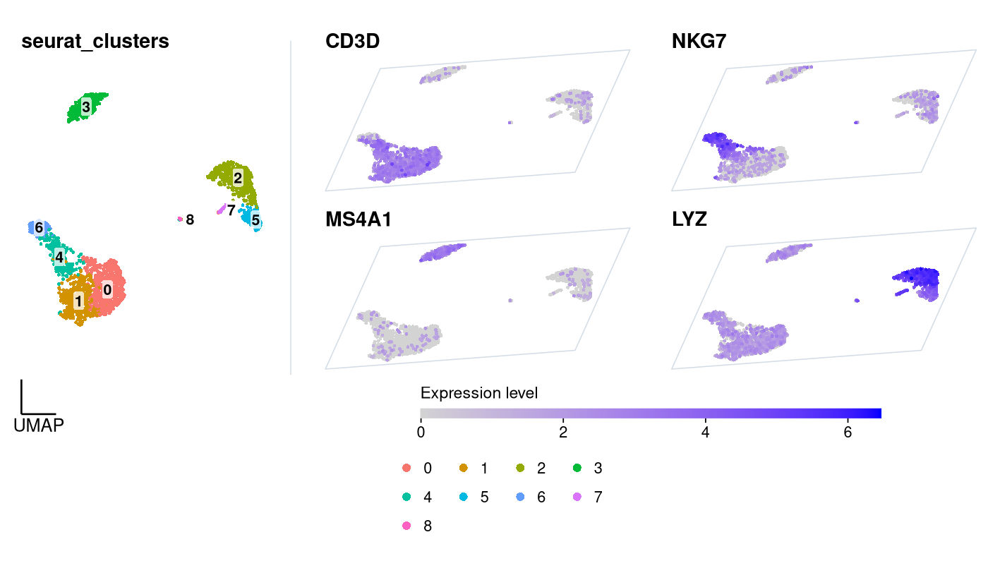
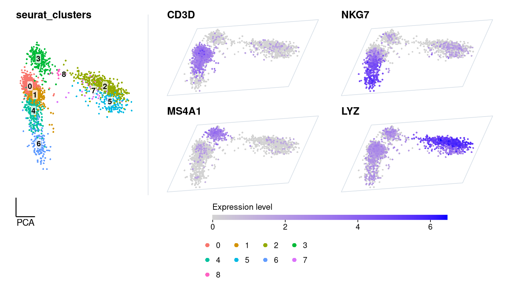
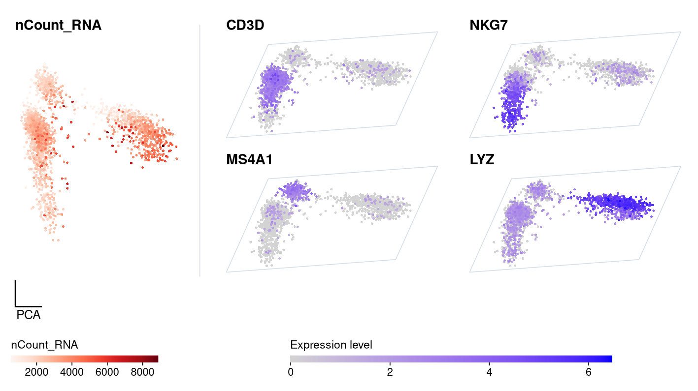
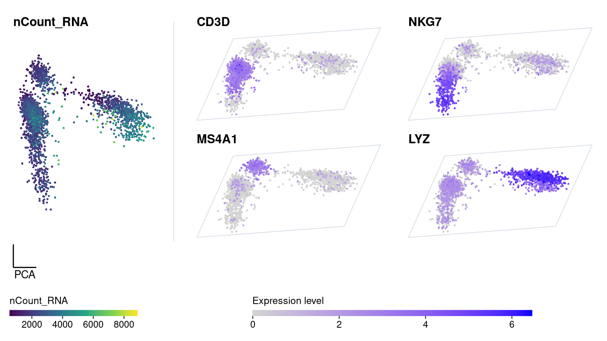
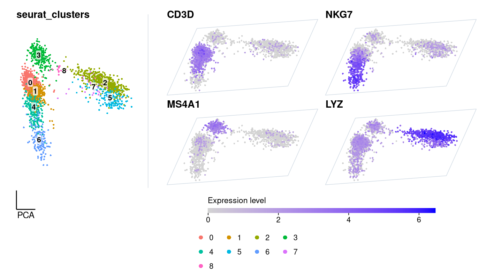
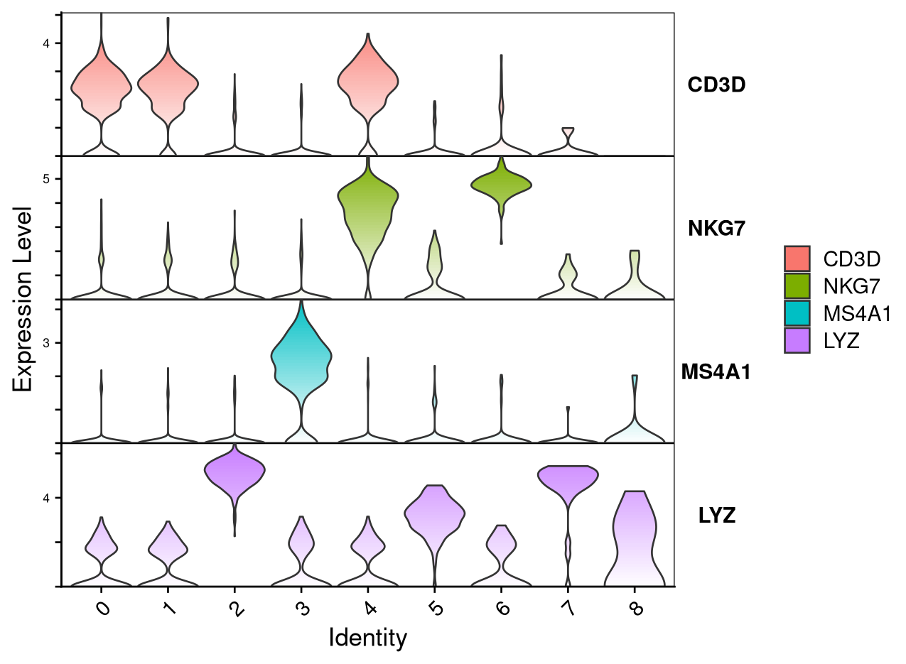
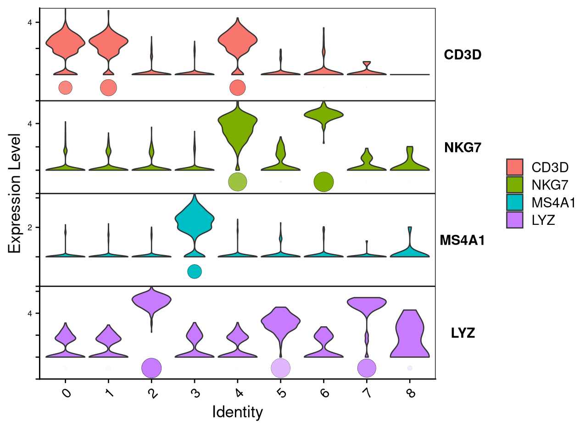
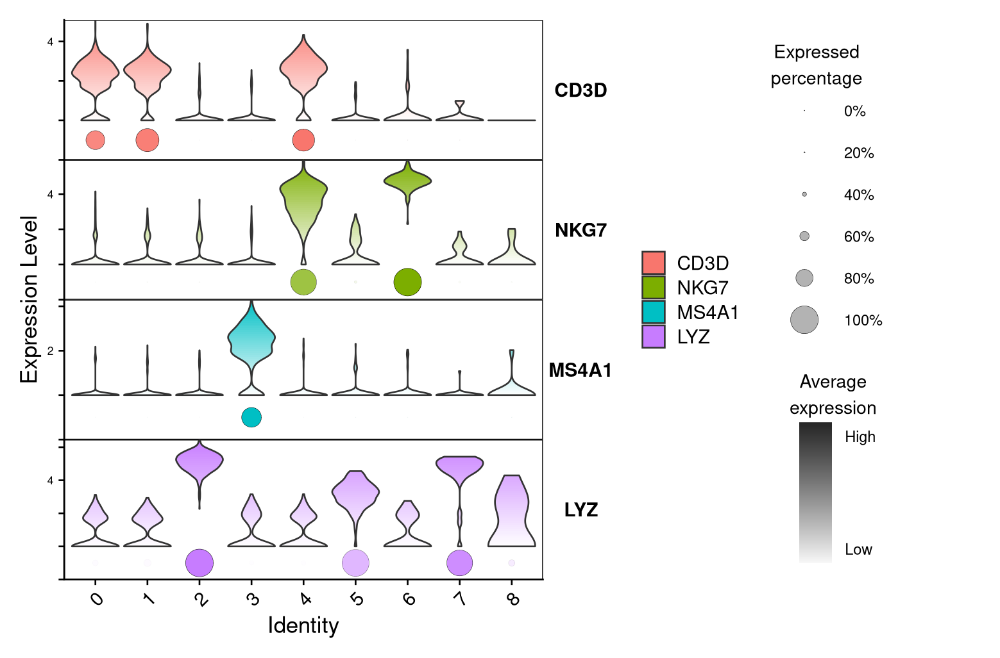
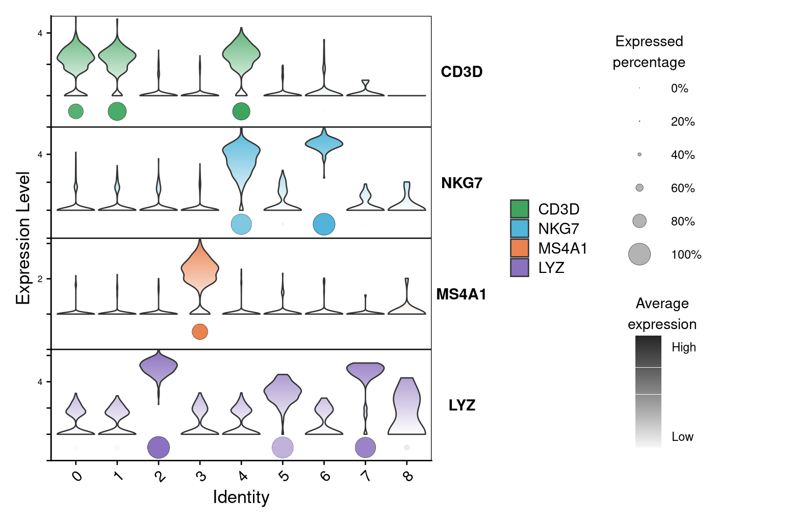

# A guided tutorial to use Seurcery v0.9.0

Use a single PBMC3K object to plot gene expression on UMAP or PCA and compare expression distributions across Seurat clusters.

[README](https://github.com/RuiyingChenBioinfo/Seurcery#readme) · [Release notes](https://github.com/RuiyingChenBioinfo/Seurcery/blob/master/NEWS.md)

## Installation

Install from GitHub, then install Seurat to run the examples below.

```r
install.packages("remotes")
remotes::install_github("RuiyingChenBioinfo/Seurcery")
install.packages("Seurat")
```

Alternatively, to install from a downloaded source archive, run the following from the directory containing the archive. Feature layers require SeuratObject \>= 5.0.0 and ggplot2 \>= 3.5.0.

```r
install.packages(c("ggplot2", "SeuratObject", "patchwork", "rlang"))
install.packages("Seurcery_0.9.0.tar.gz", repos = NULL, type = "source")
```

Load the packages:

```r
library(Seurat)
library(ggplot2)
library(Seurcery)
packageVersion("Seurcery")
# 0.9.0
```

## PBMC3K data

Install Satija Lab's PBMC3K dataset once. The processed `pbmc3k.final` object contains 2,638 cells with nine cluster IDs (0–8) in `seurat_clusters`. The cluster plots use these original IDs. All plots use the same four genes. Data from Satija Lab, [pbmc3k.SeuratData 3.1.4](https://seurat.nygenome.org/src/contrib/pbmc3k.SeuratData_3.1.4.tar.gz), licensed under [CC BY 4.0](https://creativecommons.org/licenses/by/4.0/).

```r
install.packages(
  "https://seurat.nygenome.org/src/contrib/pbmc3k.SeuratData_3.1.4.tar.gz",
  repos = NULL, type = "source"
)
```

```r
data("pbmc3k.final", package = "pbmc3k.SeuratData")
rds <- SeuratObject::UpdateSeuratObject(pbmc3k.final)
gl <- c("CD3D", "NKG7", "MS4A1", "LYZ")
```

`UpdateSeuratObject()` updates this archived object for SeuratObject v5. The RNA expression values and original cluster IDs are preserved.

## FeatureLayerPlot()

The left panel shows the original cluster IDs on the UMAP. Each projected gene panel uses the same cells and coordinates. All genes share a colorbar for expression in the RNA assay's normalized `data` layer. Each short tick below the colorbar aligns with its numeric label. In this PBMC3K example, the expression ticks mark 0, 2, 4 and 6.

```r
FeatureLayerPlot(
  rds, features = gl, group.by = "seurat_clusters",
  reduction = "umap", assay = "RNA"
)
```



PBMC3K clusters and gene expression on UMAP.

### Categorical and continuous metadata palettes

Each comparison uses the same PBMC3K cells, the first two PCs and the same four genes. Set `group.by` to choose what the left map shows and `group.scale` to choose its colors. The gene panels share their own `Expression level` colorbar, set by `feature.cols`.

#### Discrete cluster IDs

`seurat_clusters` gives each cell a cluster ID (0–8). Each ID gets a distinct color and a legend entry. To switch to the Okabe–Ito palette, name each color with its cluster ID and pass the palette to `scale_color_manual()`.

```r
FeatureLayerPlot(
  rds, gl, group.by = "seurat_clusters", reduction = "pca", assay = "RNA"
)

ids <- levels(rds$seurat_clusters)
pal <- setNames(grDevices::palette.colors(length(ids), "Okabe-Ito"), ids)

FeatureLayerPlot(
  rds, gl, group.by = "seurat_clusters", reduction = "pca", assay = "RNA",
  group.scale = scale_color_manual(values = pal)
)
```

| Default discrete colors                                                               | Okabe–Ito                                                                                             |
|---------------------------------------------------------------------------------------|-------------------------------------------------------------------------------------------------------|
|  |  |

To change one cluster, set `pal["3"] <- "#B2182B"` before plotting. You can also pass `group.scale = scale_fill_manual(values = pal)` with the same palette.

#### Continuous metadata: RNA counts per cell

With `group.by = "nCount_RNA"`, the left PCA map shows each cell’s total RNA count. The counts span 556 to 8,875. Darker red indicates a higher count on the `nCount_RNA` colorbar. Ticks below the count colorbar mark 2,000, 4,000, 6,000 and 8,000. The four gene panels use the separate `Expression level` colorbar.

```r
FeatureLayerPlot(
  rds, gl, group.by = "nCount_RNA", reduction = "pca", assay = "RNA"
)
```



Total RNA counts per cell on PCA, using the default Reds palette.

To use viridis for the same counts, pass a continuous scale to `group.scale`. High counts now appear yellow.

```r
FeatureLayerPlot(
  rds, gl, group.by = "nCount_RNA", reduction = "pca", assay = "RNA",
  group.scale = scale_color_viridis_c()
)
```



The same continuous metadata column with a viridis palette.

### Ordering and spacing

`order = TRUE` draws higher values last so they appear above lower values. This applies to gene expression and numeric metadata. `order = FALSE` keeps the original cell order.

| Argument    | Default | Meaning                                                |
|-------------|---------|--------------------------------------------------------|
| `ncol`      | `2`     | Number of gene-panel columns.                          |
| `gap.x`     | `0.18`  | Horizontal gap; must be greater than zero.             |
| `gap.y`     | `0.16`  | Vertical gap; at least `max(0.10, title.gap + 0.037)`. |
| `title.gap` | `0.04`  | Gene-title offset above its panel; at least `0.037`.   |

The embedding label appears below two equal, perpendicular black lines. Use `text.color` to set the label and title colors.

Gaps are expressed in normalized plot coordinates. Smaller values make the layout more compact. Invalid gaps cause an error before plotting, keeping the panels and their reserved title space separate.

```r
FeatureLayerPlot(
  rds, gl, group.by = "seurat_clusters", reduction = "pca",
  order = TRUE, gap.x = 0.06, gap.y = 0.11, title.gap = 0.04
)
```



PCA gene panels with reduced horizontal and vertical gaps.

## Violin and dot gradients

Start with one stacked violin plot of the same four genes, grouped by the original `seurat_clusters` IDs (0–8). `p_default` uses the colors supplied by `VlnPlot()`. For `p_gene`, the names in `gene_cols` assign each gene a color. Setting `add.noise = FALSE` keeps observed zeros at zero when calculating the percentage of expressing cells.

```r
p_default <- VlnPlot(
  rds, features = gl, group.by = "seurat_clusters", pt.size = 0,
  stack = TRUE, flip = TRUE, add.noise = FALSE
)

gene_cols <- c(CD3D = "#3FA55E", NKG7 = "#50B5D8",
               MS4A1 = "#EA8350", LYZ = "#8B72BE")
p_gene <- p_default + scale_fill_manual(values = gene_cols)
```

### geom_vln_gradient()

Within each gene panel, higher expression gives the violin a more opaque fill. Use `direction = -1` to reverse the gradient. `alpha_min` and `alpha_max` set its opacity range.

```r
p_default + geom_vln_gradient()
p_gene + geom_vln_gradient()
```

| Default colors                                                                                                  | Custom `gene_cols`                                                                                                  |
|-----------------------------------------------------------------------------------------------------------------|---------------------------------------------------------------------------------------------------------------------|
|  |  |

### geom_dot_gradient()

Each dot summarizes one cluster within one gene panel. Size shows the percentage of cells with expression above `expr_cutoff` (default 0). Opacity reflects the cluster’s average expression relative to the other clusters in that panel. `y_axis_min = -2` leaves room for the dots.

```r
p_default + geom_dot_gradient(guide = FALSE, y_axis_min = -2)
p_gene + geom_dot_gradient(guide = FALSE, y_axis_min = -2)
```

| Default colors                                                                                                          | Custom `gene_cols`                                                                                                          |
|-------------------------------------------------------------------------------------------------------------------------|-----------------------------------------------------------------------------------------------------------------------------|
|  |  |

### Combine both layers

Add both gradients and set `guide = TRUE` to display the dot size and average expression guides.

```r
p_default + geom_vln_gradient() + geom_dot_gradient(guide = TRUE, y_axis_min = -2)
p_gene + geom_vln_gradient() + geom_dot_gradient(guide = TRUE, y_axis_min = -2)
```

| Default colors                                                                                                       | Custom `gene_cols`                                                                                                       |
|----------------------------------------------------------------------------------------------------------------------|--------------------------------------------------------------------------------------------------------------------------|
|  |  |

Both addition orders and both `flip` settings are supported. `low_quantile`, `mid_quantile` and `high_quantile` specify fractions of the expression range. For violins this is the panel’s plotted range, and for dots it is the range of the cluster means in that panel.

## Contact

Ruiying Chen (<986802552@qq.com>).
