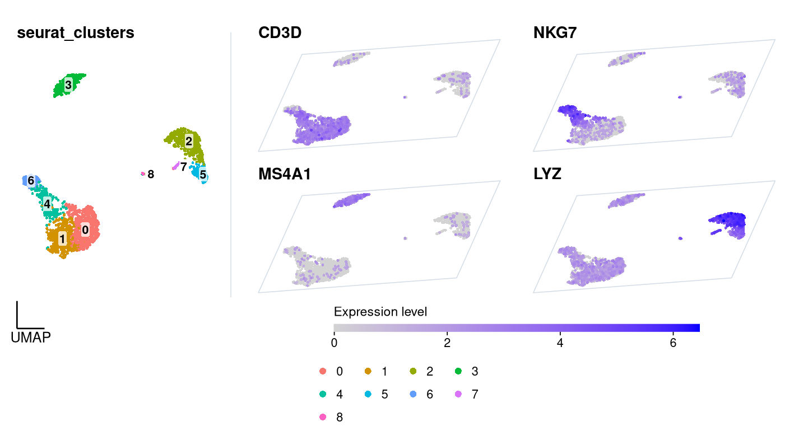
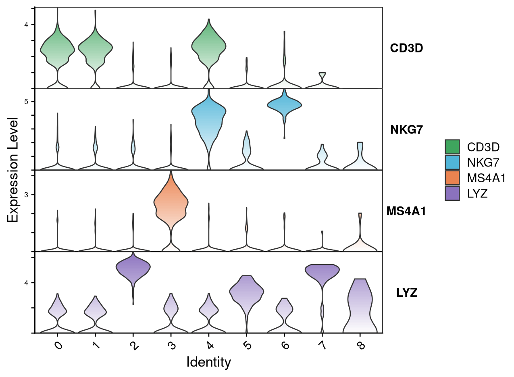
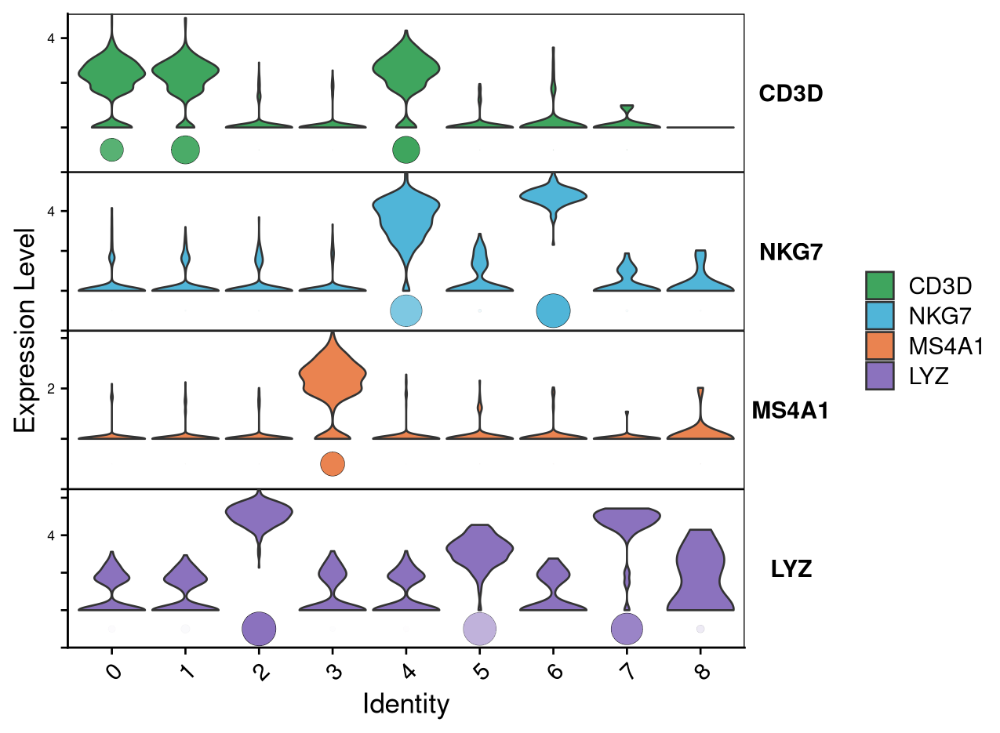

# Seurcery


An R package for extending Seurat visualizations. Version 0.9.0 adds
`FeatureLayerPlot()` for displaying multiple genes on aligned thin panels,
alongside the existing violin and dot gradients.

See the [illustrated v0.9.0 tutorial](Public/Seurcery_v0.9.0_tutorial.md)
and [NEWS.md](NEWS.md). To view the tutorial offline, open
`Public/Seurcery_v0.9.0_tutorial.html` from the downloaded repository.

<details> <summary> Note about package development </summary>

Seurcery is actively being developed. You may occasionally encounter bugs or minor documentation issues. GitHub issues are welcome for bug reports, usage questions, and feature suggestions.

</details>

## Installation

Install from GitHub:

```r
install.packages("remotes")
remotes::install_github("RuiyingChenBioinfo/Seurcery")
```

Alternatively, if you downloaded `Seurcery_0.9.0.tar.gz`, run the following
from the directory containing the archive. `FeatureLayerPlot()` requires
SeuratObject >= 5.0.0 and ggplot2 >= 3.5.0:

```r
install.packages(c("ggplot2", "SeuratObject", "patchwork", "rlang"))
install.packages("Seurcery_0.9.0.tar.gz", repos = NULL, type = "source")
```

Install Seurat to run the examples below: `install.packages("Seurat")`.

## PBMC3K example

Install the PBMC3K dataset once using the code below. The processed `pbmc3k.final`
object contains 2,638 cells with nine cluster IDs (0–8) in `seurat_clusters`.
All three plots use these IDs and the same four genes. Data from Satija Lab,
[pbmc3k.SeuratData 3.1.4](https://seurat.nygenome.org/src/contrib/pbmc3k.SeuratData_3.1.4.tar.gz),
licensed under [CC BY 4.0](https://creativecommons.org/licenses/by/4.0/).

```r
install.packages(
  "https://seurat.nygenome.org/src/contrib/pbmc3k.SeuratData_3.1.4.tar.gz",
  repos = NULL, type = "source"
)
```

```r
library(Seurat)
library(ggplot2)
library(Seurcery)

data("pbmc3k.final", package = "pbmc3k.SeuratData")
rds <- SeuratObject::UpdateSeuratObject(pbmc3k.final)
gl <- c("CD3D", "NKG7", "MS4A1", "LYZ")
```

### FeatureLayerPlot()

The left panel shows the clusters on the stored UMAP. The four gene panels use a
shared color scale for normalized RNA expression.

```r
FeatureLayerPlot(
  rds, features = gl, group.by = "seurat_clusters",
  reduction = "umap", assay = "RNA"
)
```



### geom_vln_gradient()

Start with a stacked Seurat violin plot. Within each gene panel, higher
expression has greater opacity.

```r
gene_cols <- c(CD3D = "#3FA55E", NKG7 = "#50B5D8",
               MS4A1 = "#EA8350", LYZ = "#8B72BE")
p <- VlnPlot(
  rds, features = gl, group.by = "seurat_clusters", pt.size = 0,
  stack = TRUE, flip = TRUE, add.noise = FALSE
) + scale_fill_manual(values = gene_cols)

p + geom_vln_gradient()
```



### geom_dot_gradient()

Using the same violin plot, add a dot for each cluster. Dot size shows the
percentage of cells expressing the gene. Opacity shows the cluster's average
expression relative to the other clusters in that gene panel.
`add.noise = FALSE` in the violin call above keeps zeros at zero.

```r
p + geom_dot_gradient(guide = FALSE, y_axis_min = -2)
```



The [v0.9.0 tutorial](Public/Seurcery_v0.9.0_tutorial.md) covers PCA,
manual colors, panel spacing, and combining the two gradients.

## Citation
Chen, R. (2026). Seurcery: An R package designed for further analysis and visualization based on utilities of R package Seurat [Computer software]. Zenodo (all versions). https://doi.org/10.5281/zenodo.18962435

## Contact
* Ruiying Chen (986802552@qq.com)
